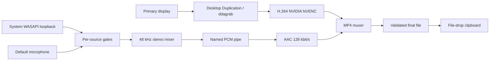
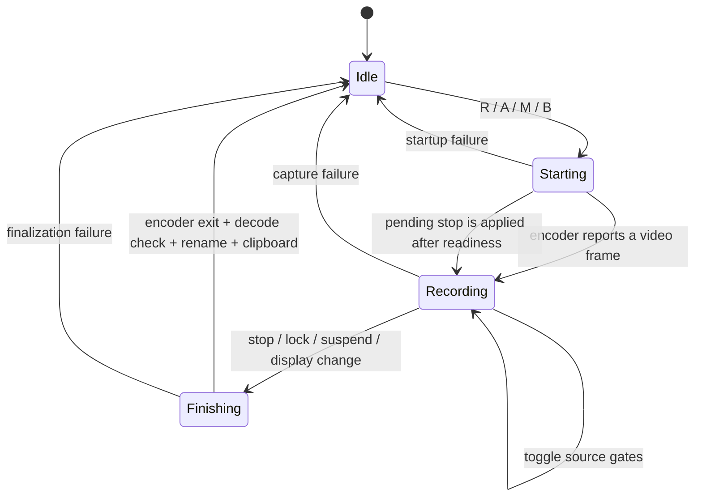

# Architecture

ScreenRecorder is a .NET Framework 4.8 x64 Windows Forms application with native
interop for desktop composition, input shortcuts, and process lifetime management.
There is no network service, account system, browser UI, or remote-control backend.

## Source map

| Component | Responsibility |
| --- | --- |
| `Program.cs` | STA entry point, single-instance mutex, graceful `--quit` dispatch |
| `MainWindow.cs` | Hidden message host, tray, session coordination, clipboard retries |
| `Hotkeys.cs` | Global shortcut registration and dedicated keyboard-hook fallback |
| `CaptureSession.cs` | Recording lifecycle, audio mode, finalization and error events |
| `DesktopInput.cs` | DXGI adapter/output selection matching the chosen Windows display |
| `EncodingProfile.cs` | Central FFmpeg arguments and Windows argument quoting |
| `VideoEncoder.cs` | FFmpeg child process, stereo pipe, progress/readiness, stop and validation |
| `StereoAudioMixer.cs` | WASAPI sources, conversion, gating, mixing and clipping protection |
| `EncoderJob.cs` | Kill-on-close Windows Job for the child encoder |
| `IndicatorWindow.cs` | HUD controls, capture exclusion and visibility restoration |
| `TrayMenuWindow.cs` | Custom glass notification-area menu |
| `Glass/` | Native premultiplied surfaces, acrylic, material and button animations |
| `SelfTest.cs` | Explicit opt-in live integration harness |

## Media flow

Desktop Duplication is bound to the DXGI adapter/output matching the Windows
device name; this avoids assuming that the display belongs to the NVIDIA adapter
on hybrid systems. FFmpeg receives native-size frames, converts to 4:2:0 and
encodes with NVENC. There is no intermediate video file or post-recording re-encode.

WASAPI sources convert their device formats to 48 kHz float stereo. The mixer
supplies 10 ms blocks through a private named pipe, paced by a monotonic clock.
Muted sources supply silence, so the MP4 timeline and stereo layout remain stable.
Audio EOF and FFmpeg `-shortest` coordinate stopping; abrupt keyboard quit is not
used because it can flush delayed video beyond the audio end.

## Lifecycle

Pending recordings use `.recording.mp4`. A successful encoder exit and decoded
video-frame check are required before renaming to `.mp4`. Failure leaves the
pending file for investigation. Clipboard failure does not delete a valid file.
The encoder is attached to a kill-on-close Job so it cannot survive app termination.

## UI and input

The hidden host owns hotkey messages and the WinForms synchronization context.
Registered hotkeys use no-repeat. Conflicts use a separate low-level hook thread
which intercepts only the configured modifier/key combinations and posts commands
back to the UI; capture startup never runs inside the hook callback.

Glass windows use 32-bit premultiplied DIBs, native BitBlt, compositor alpha and
accent acrylic. The undocumented accent API has fallbacks, but visual equivalence
across Windows versions is not guaranteed. Buttons share an optical material and
spring model; the whole panel stays fixed during hover. DWM owns outer rounding.

The HUD requests capture exclusion, restores its topmost position after relevant
window events and every session tick, and resists minimize/hide requests while
recording. These mechanisms stay within the interactive desktop and do not provide
exclusive-fullscreen, Secure Desktop, or cross-session guarantees.

## Configuration boundaries

There is no user settings window. The active encoding contract lives in
`EncodingProfile.cs`; the display selection defaults to the primary monitor.
`AppData.cs` also contains legacy settings helpers not currently loaded as a public
settings API. Keep user-facing documentation aligned with actual session setup.
